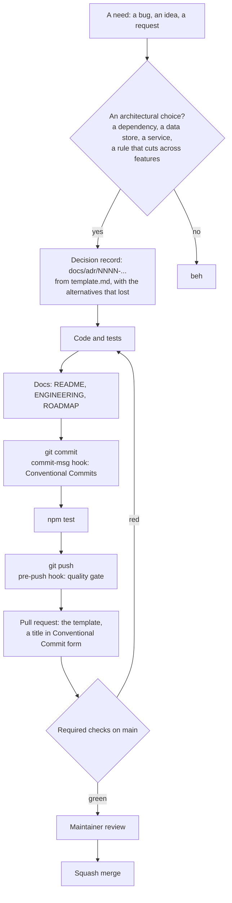

# Contributing

Thank you for helping with my-skills. This page is the map: how a change
goes from a need to a release, what is checked and where, and what a commit
looks like. People and coding agents follow the same path (`AGENTS.md` holds the
short rules for agents).

Everyone taking part follows the [code of conduct](CODE_OF_CONDUCT.md).

## What helps most

1. **A bug report with its output.** `project-foundation status` and the answers from `.project-foundation.json`, plus what you ran.
2. **A stack that is missing or wrong.** A profile in `skills/project-foundation/assets/profiles.json`, with a test that renders it
   ([how to add one](skills/project-foundation/references/stacks.md#adding-a-stack)).
3. **A template that does not hold up on a real repository.** Say which file, what the repository looked like, and what you expected.
4. **Another agent.** A thin file that points to `AGENTS.md`, as for Claude and Gemini; never a second copy of the rules.
5. **Documentation** that would have saved you time.

## Setup

```bash

sh scripts/setup-hooks.sh   # once per clone: the git hooks
npm test             # the gate: it must pass before you push
```

## Workflow

The path every change follows, from the need to the release. `docs/EVOLVING.md`
explains each step; this page is the map.



### What do I do for my change?

| Your change                                                  | Do                                                                              |
| ------------------------------------------------------------ | ------------------------------------------------------------------------------- |
| An architectural choice                                      | A decision record in `docs/adr/`, committed first.                              |
| A bug fix                                                    | A test that fails first, then the fix.                                          |
| Docs only                                                    | Nothing more to do.                                                             |

### What is checked, where, and can it be skipped

| When         | What runs                                                                | Skippable?                                              |
| ------------ | ------------------------------------------------------------------------ | ------------------------------------------------------- |
| `git commit` | commit-msg: Conventional Commits. | `--no-verify`, or no hooks installed yet                |
| `git push`   | pre-push: `npm test`. | `--no-verify`, `SKIP_PRE_PUSH=1`, or no hooks installed |
| Pull request | CI: the quality gate, the PR title, CodeQL. | **No.** Required checks on `main`; only an administrator can merge past them. |
| Merge        | GitHub merges when the required checks are green. A person reads the pull request. | Administrators                                |

A git hook is a convenience on one machine: it can be skipped, and a fresh clone has none until
`sh scripts/setup-hooks.sh`. The pull-request checks cannot be skipped, so they are the rule.

### In steps

1. Branch from `main`: `feat/...`, `fix/...`, `docs/...`, `chore/...`.
2. Decide as the chart shows: a decision record, or a reason for none.
3. Code with tests. Never let a test reach a paid or external service for real.
4. `npm test` must pass.
5. Commit with Conventional Commits, one concern per commit, in the order of the chart.
6. Open a pull request with the template filled in: the decision and spec, what was verified, what was not. The **PR
   title follows the commit convention too**: a squash merge turns it into the commit on `main`.

## Commits

Conventional Commits, enforced by the commit-msg hook and in CI:

```
<type>(<scope>): <subject>

<body: what and why, wrapped at 120 columns, optional>

<footer: BREAKING CHANGE: ..., Refs #12, optional>
```

### Types

| Type       | Use for                                          | Release effect                 |
| ---------- | ------------------------------------------------ | ------------------------------ |
| `feat`     | A capability users did not have before           | minor version                  |
| `fix`      | Wrong behaviour corrected                        | patch version                  |
| `perf`     | Same behaviour, faster or cheaper                | patch version                  |
| `refactor` | Code change with no behaviour change             | none                           |
| `docs`     | README, docs, decision records, comments         | none (listed in the changelog) |
| `test`     | Tests only                                       | none                           |
| `build`    | Dependencies, tooling, build scripts             | none (listed in the changelog) |
| `ci`       | CI workflows, Dependabot, release automation     | none                           |
| `chore`    | Housekeeping that fits nowhere else              | none                           |
| `style`    | Formatting, no logic change                      | none                           |
| `revert`   | Reverts a previous commit; the subject names it  | depends on what is reverted    |

A breaking change adds `!` after the scope, `feat(api)!: ...`, and a `BREAKING CHANGE:` footer explaining the migration.

### Scopes

Lower-case, kebab-case, the area touched, for example: project-foundation, site, docs, ci, deps. A scope is optional for changes that span the
project (`docs: ...`, `build: ...`).

### Subject and body

- Imperative, present tense: "add", "fix", "remove", not "added" or "adds".
- No trailing period, at most 100 characters for the whole header.
- A body when the why is not obvious from the diff: what changed, why, what was verified. Reference issues in the footer:
  `Refs #12`, `Closes #12`.
- One concern per commit. A pull request with a feature, its tests and its docs is three commits, or one `feat` commit
  when they are inseparable.

### Examples

```
feat(api): accept a time zone on every request
fix(parser): reject a negative length instead of wrapping
perf(index): skip unchanged files on reload
refactor(core): share the validation between the CLI and the server
docs(adr): record why the cache is a single file
test(parser): cover the empty input
build(deps): bump the HTTP client
ci: run the tests on two runtime versions
chore: remove scratch exports
revert: "feat(api): accept a time zone on every request"
```
No attribution trailers or generated-by footers in commits or pull requests.

## Licence of contributions

Contributions are accepted under the project's MIT licence; by opening a pull request you agree to it.

## Code conventions

Keep in step with `AGENTS.md`:

- **A template and its test change together.** `tests/project-foundation.test.mjs` renders every stack, a monorepo and the options;
  a template change that no test would notice is untested.
- **Dependency-free.** The engine uses the Node standard library; the hooks are POSIX shell; CI installs nothing beyond Node.
- **Never overwrite, never guess.** An unknown variable is an error, not an empty string. A file that exists is skipped.
- **Say the same thing everywhere.** A rule that appears in `AGENTS.md`, `CONTRIBUTING.md`, the Copilot digest and a hook is changed in
  all of them, in one commit.
- **Bump `skills/project-foundation/VERSION`** when a template or the engine changes: it is the version `status` reports.
- **The site is built from the real tool.** Nothing on it that looks like output is typed by hand (`scripts/build-site.mjs`).
- **The documentation is one connected guide.** After editing a page, run `npm run docs`: it rewrites the navigation blocks and the list of
  generated files, and `npm test` fails on a broken link, anchor or image.

<!-- docs-nav:start -->
---
**Documentation:** [Start here](./docs/start-here.md) · [Guides](./docs/guides/new-project.md) · [Concepts](./docs/concepts.md) · [Reference](./docs/cli.md) · [Glossary](./docs/glossary.md) · [All pages](./docs/README.md)

← [Architecture decision records](./docs/adr/README.md) · [Roadmap](./ROADMAP.md) →
<!-- docs-nav:end -->
