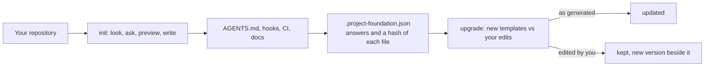

# project-foundation

**One rules file for every coding agent.** `project-foundation` sets a repository up so that Claude Code, Codex, Gemini CLI and
GitHub Copilot, and the people beside them, all work by the same rules: one `AGENTS.md`, git hooks and CI that enforce it, a
workflow from idea to release, and decision records that explain why. For one project or a monorepo of several stacks.

<!-- badges:start -->
[](https://github.com/bhoudebert/my-skills/actions/workflows/ci.yml) [](https://github.com/bhoudebert/my-skills/actions/workflows/codeql.yml) [](LICENSE)
<!-- badges:end -->

It is an [agent skill](https://github.com/vercel-labs/skills) and a command. Ask your agent to "bootstrap this repository", or
run `project-foundation init` yourself: it reads your repository, asks only what it cannot see, shows what it would write, and
writes it. It never overwrites a file, and `upgrade` later brings the generated files up to date without touching your edits.

## Install

```bash
npx skills add bhoudebert/my-skills        # the skill, for the agents you choose (project scope; -g for every project)
npx github:bhoudebert/my-skills init       # or run the command without installing anything
```

Needs Node 22 or later. To keep the command on your `PATH`, run `npm link` in a clone: `project-foundation` and `my-skills`
both point at it, and `git pull` updates it.

## Use

From the repository to set up:

```bash
project-foundation init --dry-run     # see what it would write; nothing is written
project-foundation init               # ask, confirm, write
project-foundation status             # which version made this repository; did the templates change since
project-foundation upgrade            # what differs from the current templates; --apply writes the safe changes
project-foundation badges             # README badges that can say something true; --apply writes them
```

Or with an agent that has the skill installed: *"use project-foundation to bootstrap this repository"*. The agent looks first,
sends one message with what it found and the choices it proposes, waits for your answer, and shows the file list before it writes.

## What you get

About forty files, depending on your answers:

| | |
| --- | --- |
| **Agent rules** | `AGENTS.md`, the single source; `CLAUDE.md` and `GEMINI.md` import it; `.github/copilot-instructions.md` is a short digest; path-specific Copilot files |
| **Workflow** | `CONTRIBUTING.md` with the drawing from need to release, `docs/EVOLVING.md`, pull request and issue templates |
| **Decisions** | `docs/adr/` with a template and three seed records |
| **Enforcement** | tool-neutral shell hooks (Conventional Commits, no commit or push on the default branch, the quality gate before a push) and the same checks in CI |
| **CI** | one workflow with a job per component and a single required check, `Quality gate`; the PR title check; CodeQL |
| **Automation** | Dependabot; release-please when you want it |
| **Community** | README skeleton, `SECURITY.md`, `SUPPORT.md`, `CODE_OF_CONDUCT.md`, `LICENSE`, `ROADMAP.md` |
| **Options** | a Nix dev shell with direnv; spec-driven development with a drift reviewer |

Stacks: Node and TypeScript, Java (Maven, Gradle), Rust, Python, Go, and an "other" profile. A monorepo mixes them: each
component gets its own job, toolchain pin, agent instructions and Dependabot entry.

## How it works



`init` records what it wrote. `upgrade` compares that record with the current templates: a file you have not touched is updated,
a file you edited is never overwritten, and when both changed the new version lands next to yours as `<file>.upstream`.

## Documentation

- [Getting started](docs/getting-started.md): from zero to a repository that follows the rules.
- [Concepts](docs/concepts.md): one rulebook, enforcement in git and CI, branch before the first edit, upgrades, monorepos.
- [Command reference](docs/cli.md): every command, option, answer and environment variable.
- [Troubleshooting](docs/troubleshooting.md): the problems people actually hit, and what to do.
- [Engineering](docs/ENGINEERING.md): how the engine is built, and how to change a template.
- [Decision records](docs/adr/README.md) and [the workflow this repository follows](docs/EVOLVING.md).
- [The site](https://bhoudebert.github.io/my-skills/) shows the real output of the tool.

## Contributing

This repository follows the rules it generates. Read [CONTRIBUTING.md](CONTRIBUTING.md), then:

```bash
sh scripts/setup-hooks.sh   # once per clone
npm test                    # the quality gate
```

## Licence

[MIT](LICENSE).
