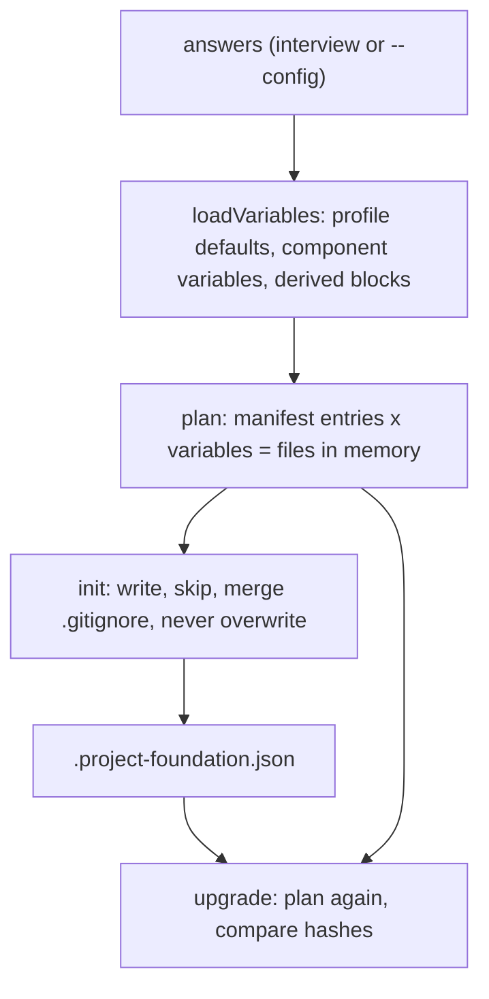

# Engineering

How `project-foundation` is built, and how to change it.

## Overview

A command (`skills/project-foundation/scripts/foundation.mjs`) turns an answers file into files. It does four things and nothing
else: it **looks** (stacks, git remote), **asks** (an interview that builds the answers), **renders** (templates plus the answers)
and **records** (what it wrote, with hashes, so a later `upgrade` can tell a template change from your edit). It is also an agent
skill: `SKILL.md` tells an agent how to drive the same command.



## Layout

```
skills/project-foundation/
  SKILL.md                 what an agent reads when the skill triggers
  VERSION                  the version recorded in every repository it generates
  scripts/foundation.mjs   the command: init, status, upgrade, badges, list, version
  scripts/lib/render.mjs   the template engine
  scripts/lib/answers.mjs  answers to variables, and the blocks of text built from the components (derive)
  scripts/lib/interview.mjs  detection and the questions
  scripts/lib/badges.mjs   README badges
  assets/profiles.json     the stacks: commands, tool names, ecosystems, release types
  assets/manifest.json     which template becomes which file, in which module, under which condition
  assets/templates/        the templates (spec-driven/scripts is vendored code, copied raw)
  references/              documents an agent loads when it needs detail
tests/                     renders every stack, a monorepo, the options, upgrade and the command line
site/                      the site; scripts/build-site.mjs builds it from the real tool
```

## Template syntax

`@@name@@` is a variable; an unknown name is an error. `@@#if name@@ … @@/if@@` and `@@#unless name@@ … @@/unless@@` are blocks, nestable;
a tag alone on its line removes the line. The delimiters were chosen so that GitHub Actions' `${{ }}` and shell's `[[ ]]` need no
escaping. A removed block can leave blank lines; the renderer collapses three newlines to two, and a test fails on a heading or table
that touches the text before it.

## Components

A single project is a monorepo with one component at the root, so there is one code path. A manifest entry with
`"for_each": "component"` is rendered once per component, with the component's variables over the root's. Blocks of text built from
all components (`components_table`, `ci_jobs`, `dependabot_updates`, `codeql_matrix`, `release_packages_json`, `quality_functions`, …)
are made in `derive()`: when a root file lists the components, add the block there, not as a loop in a template.

## Provenance

`init` writes `.project-foundation.json`: skill version, source commit (when the skill runs from a git checkout), a hash of the
templates, the answers (with the date, frozen), and a SHA-256 per generated file. `upgrade` renders again with the recorded answers
and sorts each file by comparing three hashes: recorded, current, new. `.gitignore` and `.env.example` are merged, never hashed.

## Tests

```bash
npm test                                   # the quality gate
YAML_NODE_PATH=/path/to/node_modules npm test   # also parses the generated workflows (needs the `yaml` package)
```

They render every profile with and without spec-driven, a five-stack monorepo and the Nix shell; check that nothing is left
unrendered, that JSON and shell scripts parse, that the Markdown is tidy, that the agent files fit their limits (Codex 32 KiB, Copilot
4,000 characters) and that links between generated files resolve; run the commit check against accepted and rejected messages; and run
the hooks and `quality.sh` in real git repositories.

## The site

`node scripts/build-site.mjs` runs the engine and the generated hooks in a throwaway repository and puts what they print on the page:
the `init` session, the file tree, a refused commit and push, the `upgrade` states, the file counts behind each switch. It fails when
two numbers on the page disagree. `.github/workflows/pages.yml` builds and publishes it.

## Changing something

1. Edit the template, and `profiles.json` or `manifest.json` if the set of files or commands changes.
2. Run `npm test`.
3. If a rule changes, change it in every place that states it, in one commit.
4. Bump `skills/project-foundation/VERSION`.

## Key decisions

- [0001](adr/0001-record-architecture-decisions.md) Record architecture decisions
- [0002](adr/0002-conventional-commits-and-automated-releases.md) Conventional Commits and automated releases
- [0003](adr/0003-one-agent-instruction-file.md) One agent instruction file for every agent
