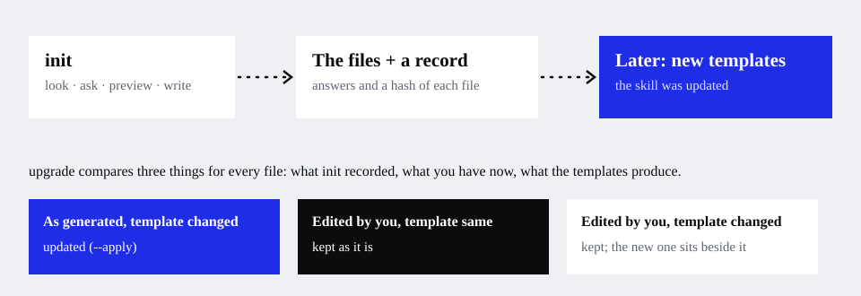
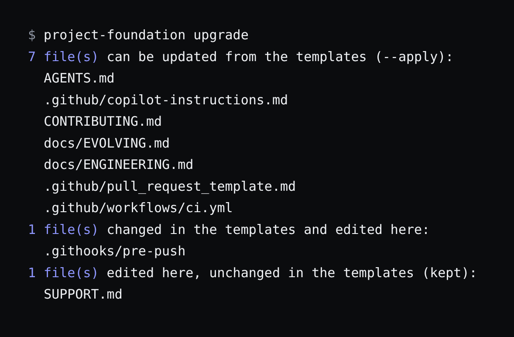

# Keep it up to date

**Use this when** the skill has a new version, or you want to change a choice you made at `init`.



## Is there something new?

```bash
project-foundation status
```

It says which version generated the repository, which version you have installed, and whether the templates changed in between (exit
code 1 when they did).

To update the skill itself:

```bash
npx skills update        # the skill, from where you installed it
```

A skill installed from a local clone is not checked by `npx skills check`; install from GitHub (`npx skills add bhoudebert/my-skills`)
for that to work.

## See what would change

```bash
project-foundation upgrade
```

Nothing is written. For each generated file it compares three things: what `init` recorded, what you have now, and what the new
templates produce.



| The file is… | The templates… | `upgrade` |
| --- | --- | --- |
| as generated | changed | **can be updated** |
| as generated | the same | nothing to do |
| edited by you | the same | **kept** |
| edited by you | changed | **conflict**: yours stays; the new version goes next to it as `<file>.upstream` |
| deleted by you | any | stays deleted |
| missing before | now produced | **new** |

## Apply the safe changes

```bash
project-foundation upgrade --apply
```

It writes the updated and new files and leaves `<file>.upstream` beside each conflict. It never overwrites a file you edited. Merge what
you want from each `.upstream`, delete it, and commit.

Do this on a branch (`chore/update-project-foundation`), in its own pull request, never mixed into other work. If the skill itself is
committed in your repository, its update is a separate commit and pull request too.

## Change a choice later

You chose "no Nix" and now want it; the project does not use `ruff`; a stack changed. Give the new answer, not a hand edit:

```bash
project-foundation upgrade --set nix=true --set quality_cmd="flake8 . && pytest"            # preview
project-foundation upgrade --set nix=true --set quality_cmd="flake8 . && pytest" --apply    # write, and save the answers
```

`--set key=value` changes one answer on top of the recorded ones (`true`, `false` and numbers are read as such). To start from a whole
answers file instead, use `--config answers.json`.

The rules, the CI and the docs change together, and the new answers are saved in `.project-foundation.json` so later runs start from
them. Editing only a hook would leave `AGENTS.md` and CI still saying the old thing.

`.gitignore` and `.env.example` are only ever added to: turning Nix on adds `.direnv/` and `result` to `.gitignore`; yours are never
removed.

## If something goes wrong

- **`status` says the templates changed but `upgrade` finds nothing**: the recorded hash covers all templates, including stacks you do
  not use. Run `upgrade --apply` once and it is recorded as current.
- **A conflict you do not understand**: open `<file>.upstream` and your file side by side, or run `git diff --no-index file file.upstream`.
- More: [Troubleshooting](../troubleshooting.md#upgrade-lists-a-file-as-a-conflict).

<!-- docs-nav:start -->
---
**Documentation:** [Start here](../start-here.md) · [Guides](./new-project.md) · [Concepts](../concepts.md) · [Reference](../cli.md) · [Glossary](../glossary.md) · [All pages](../README.md)

← [Set up a monorepo with several stacks](./monorepo.md) · [How your agents will behave](./working-with-agents.md) →
<!-- docs-nav:end -->
