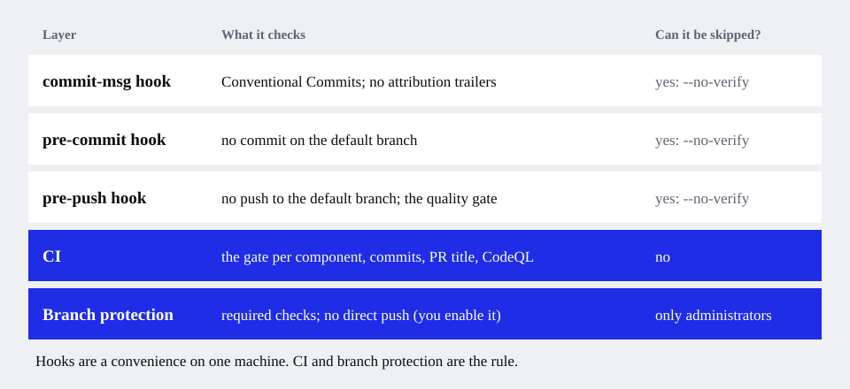

# Set up a monorepo with several stacks

**Use this when** one repository holds more than one project, possibly in different languages: a Rust API, a Python worker and a
Node web app, say.

## The idea

A repository is a list of **components**. Each has a name, a folder and a stack. The shared rules, hooks, decision records and one CI
workflow live at the root. Each component adds what is its own.

| At the root, once | Per component |
| --- | --- |
| `AGENTS.md` (with a table of components), `CONTRIBUTING.md`, `docs/` | `<folder>/AGENTS.md`, `CLAUDE.md`, `GEMINI.md`: agents read the nearest one |
| git hooks, `scripts/quality.sh` | a toolchain pin (`.nvmrc`, `rust-toolchain.toml`, `.python-version`) |
| one `ci.yml`, one release workflow | a CI job, a Dependabot entry, a release package |
| the PR template and issue templates | a short Copilot rules file for its folder |

## 1. Let it detect your components

If your stacks live in folders (`services/api/Cargo.toml`, `web/package.json`…), `init` finds them:

```bash
npx github:bhoudebert/project-foundation init --dry-run
```

It prints `Found: rust in services/api, python in services/worker, node in web` and asks for a name for each. Names are kebab-case: they
become commit scopes (`feat(api): …`) and CI job names.

## 2. Or describe them yourself

Write an answers file and pass it:

```json
{
  "project_name": "Acme Platform",
  "project_slug": "acme-platform",
  "description": "API, workers and web app.",
  "owner": "acme",
  "repo": "platform",
  "components": [
    { "name": "api", "path": "services/api", "profile": "rust" },
    { "name": "worker", "path": "services/worker", "profile": "python", "owner": "data-team" },
    { "name": "web", "path": "web", "profile": "node" }
  ]
}
```

```bash
npx github:bhoudebert/project-foundation init --config answers.json
```

An optional `owner` on a component adds a CODEOWNERS line for its folder. Any profile value can be overridden per component
(`quality_cmd`, `runtime_version`, …); see the [reference](../cli.md#the-answers-file).

## 3. Know what CI does

CI runs only the components a pull request touches, then one final job, **`Quality gate`**, waits for them. **Make `Quality gate` the
only required check.** A path filter on the whole workflow would leave a required check pending forever on a pull request that does not
touch its paths.



## 4. Run only what you changed, locally

```bash
sh scripts/quality.sh              # every component
sh scripts/quality.sh --changed    # the components this branch changed (the pre-push hook runs this)
sh scripts/quality.sh api web      # some of them
```

## Limits to know

- Spec-driven development is refused for a monorepo (the spec reviewer assumes one `src/` layout).
- A component cannot live at the repository root beside others: give it a folder.
- A change that crosses components is checked by each component's own gate, and by the jobs that run because both folders changed. A
  contract test between components is yours to write.

Design details: [Monorepos with several stacks](../../skills/project-foundation/references/monorepo.md).

<!-- docs-nav:start -->
---
**Documentation:** [Start here](../start-here.md) · [Guides](./new-project.md) · [Concepts](../concepts.md) · [Reference](../cli.md) · [Glossary](../glossary.md) · [All pages](../README.md)

← [Add it to a repository you already have](./existing-repository.md) · [Keep it up to date](./keep-up-to-date.md) →
<!-- docs-nav:end -->
