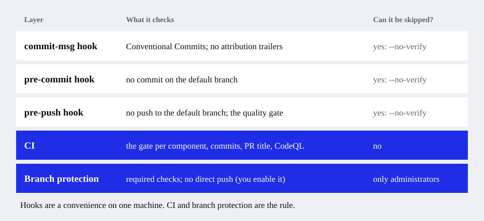
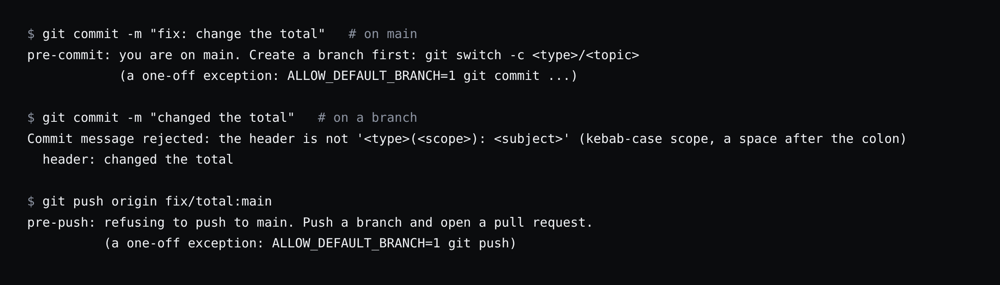

# How your agents will behave

**Read this** to know what the rules make a coding assistant do, what stops it when it does not, and what you are expected to do.

## The rules an agent is given

The generated `AGENTS.md` is read by Codex and Copilot directly, and imported by Claude Code (`CLAUDE.md`) and Gemini CLI
(`GEMINI.md`). The part that changes day-to-day behaviour is **Starting and delivering a change**:

1. **Before the first edit of any task**, including running a generator, the agent runs `git branch --show-current`.
2. **On `main`:** it does not edit there. It updates `main`, creates `<type>/<short-topic>` (`feat/`, `fix/`, `docs/`, `chore/`), tells
   you the name, and carries on. It does **not** ask first: starting a branch is part of the task.
3. **On another branch:** it asks once, "You are on `x`: is this the right place, or should I start a new branch from `main`?", and
   remembers the answer for the task.
4. **Staging:** it stages only the files of its task (`git add <paths>`), never `git add -A` or `git commit -a`. Anything else in the
   working tree is not its to commit.
5. **Delivering:** it commits (one concern per commit, in Conventional Commits form), runs the quality gate, pushes the **branch**
   (never `main`), opens the pull request with the template, reports the URL and **stops**. It never merges.

You can choose, at `init`, that agents stop after the commit instead of opening the pull request (`agent_opens_prs: false`).

## What stops it when it does not follow the rules

An instruction is a request. Git and GitHub are the rule.

- A **commit on `main`** is refused, except the repository's first commit. The exception for one commit is
  `ALLOW_DEFAULT_BRANCH=1`.
- A **push to `main`** is refused, and skipping the quality gate (`SKIP_PRE_PUSH=1`) does not lift that.
- A **commit message** that is not a Conventional Commit is refused; with the attribution rule on, so is a `Co-authored-by` or
  "Generated with" line.
- Hooks can be skipped with `--no-verify`, so **CI checks the same things**, and **branch protection** on GitHub, which you enable, is
  the final rule. See [Protect main on GitHub](github-setup.md).

## What you are expected to do

- **Review and merge.** The agent never merges its own pull request.
- **Say where to work** when you want a branch reused: "continue on this branch".
- **Keep the gate real.** If the quality gate is a placeholder, the agent's "tests pass" means nothing.
- **Fill the placeholders** in `AGENTS.md` ("Code conventions") with what a newcomer would get wrong: the agent reads them.

## Why a hook cannot do it all

A git hook sees a commit or a push, not an edit. By then the work is already on the wrong branch. So the branch check is an
instruction that runs first, and the hooks are the backstop. If an agent edits on `main` anyway, it will be stopped at the commit, and
told how to move its work to a branch (`git switch -c <type>/<topic>` carries the changes along).

## If an agent ignores the rules

- **It never read the file.** Start a new session after installing or updating the rules: agents read instruction files at session
  start.
- **It is a tool we do not cover.** Add a thin file for it that points to `AGENTS.md`; never paste the rules in.
- More: [Troubleshooting](../troubleshooting.md#an-agent-edits-on-main).

<!-- docs-nav:start -->
---
**Documentation:** [Start here](../start-here.md) · [Guides](./new-project.md) · [Concepts](../concepts.md) · [Reference](../cli.md) · [Glossary](../glossary.md) · [All pages](../README.md)

← [Keep it up to date](./keep-up-to-date.md) · [Protect main on GitHub](./github-setup.md) →
<!-- docs-nav:end -->
