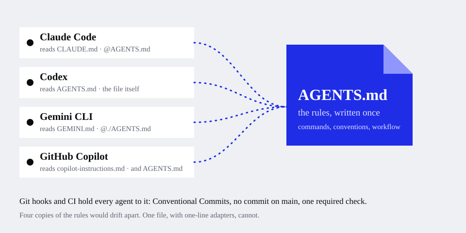
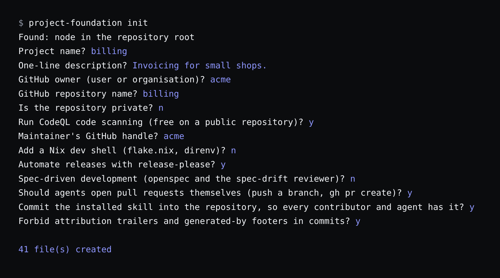

# Start here

For anyone, with no jargon needed. A word you do not know is in the [glossary](glossary.md).

## The problem, in one picture

AI coding assistants now work on your code: Claude Code, Codex, Gemini CLI, GitHub Copilot. Each one reads a **different file** to
learn how your project works. Without shared rules, each one guesses: how to name a branch, how to word a commit, whether to run the
tests, whether it may change `main` directly.



Think of ants. A trail is laid once and every ant follows it. **`AGENTS.md` is the trail, and each assistant is an ant.** One file
holds the rules; the other files are one-line pointers to it.

## What project-foundation does

It is a small command, and also a skill your agent can use. You give it a repository; it does four things, in this order:

1. **Looks** at the repository: which languages it uses, where it lives on GitHub.
2. **Asks** only what it cannot see, such as the project name or whether the repository is private.
3. **Previews** every file it would write. Nothing is written yet.
4. **Writes** the files, and never overwrites one that already exists.



*That is the real output of the command, not a mock-up.*

## What you end up with

| You get | In plain words |
| --- | --- |
| **The rules file** | `AGENTS.md`: how to branch, commit, test and deliver. Every assistant follows it. |
| **Guards on your machine** | small scripts (git hooks) that refuse a badly worded commit, a commit on `main`, or a push to it |
| **Checks on GitHub** | a workflow that runs your tests on every pull request, plus one check, `Quality gate`, that you can make mandatory |
| **Housekeeping** | weekly dependency updates, a security scan, an optional automatic release |
| **Documents** | `CONTRIBUTING.md` with a drawing of the whole workflow, templates for pull requests and issues, a place for design decisions |

About forty files in all, [each one explained](generated-files.md).

## Is it for me?

| If you… | Then |
| --- | --- |
| are starting a new project | run it first: the rules are there from the first commit ([guide](guides/new-project.md)) |
| have a repository with scattered or no rules | add it without losing anything: existing files are never touched ([guide](guides/existing-repository.md)) |
| use more than one AI assistant | this is exactly the case: one rulebook for all of them |
| keep several languages in one repository | it handles that ([guide](guides/monorepo.md)) |
| only want a README template | this is more than you need |
| do not use GitHub | the files assume GitHub (workflows, templates, links) |

## Try it in five minutes, safely

You need [Node](https://nodejs.org) 22 or later. From your repository:

```bash
npx github:bhoudebert/project-foundation init --dry-run
```

`--dry-run` means *show me, but write nothing*. Read the list. If it looks right:

```bash
npx github:bhoudebert/project-foundation init
```

It asks a handful of questions (press Enter to accept the proposed answer), shows your answers, and asks before writing.

The full walk-through, with every step checked, is the [quickstart](getting-started.md).

## What it will never do

- **Overwrite a file.** One that exists is skipped and listed. `.gitignore` only gains lines it lacks.
- **Change your git history or settings.** It does not commit, push or touch GitHub; it lists the commands for you to run.
- **Phone home.** The generator uses no network. No model takes part in writing the files.
- **Hide what it did.** It records its answers and a fingerprint of every file, so a later `upgrade` can tell your edits from its own.

## Where next

- [Quickstart](getting-started.md): from zero to a repository that follows the rules.
- [How your agents will behave](guides/working-with-agents.md): what the rules make an assistant do.
- [Concepts](concepts.md): why the files are shaped this way.
- [Troubleshooting](troubleshooting.md): the first things that go wrong.

<!-- docs-nav:start -->
---
**Documentation:** [Start here](./start-here.md) · [Guides](./guides/new-project.md) · [Concepts](./concepts.md) · [Reference](./cli.md) · [Glossary](./glossary.md) · [All pages](./README.md)

← [Documentation](./README.md) · [Getting started](./getting-started.md) →
<!-- docs-nav:end -->
